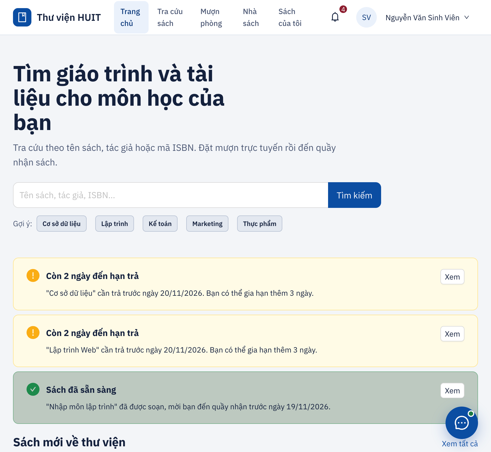
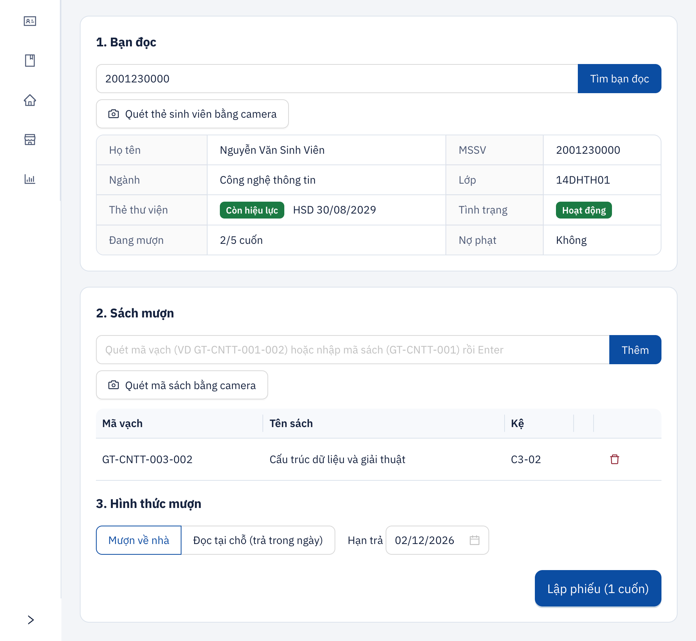
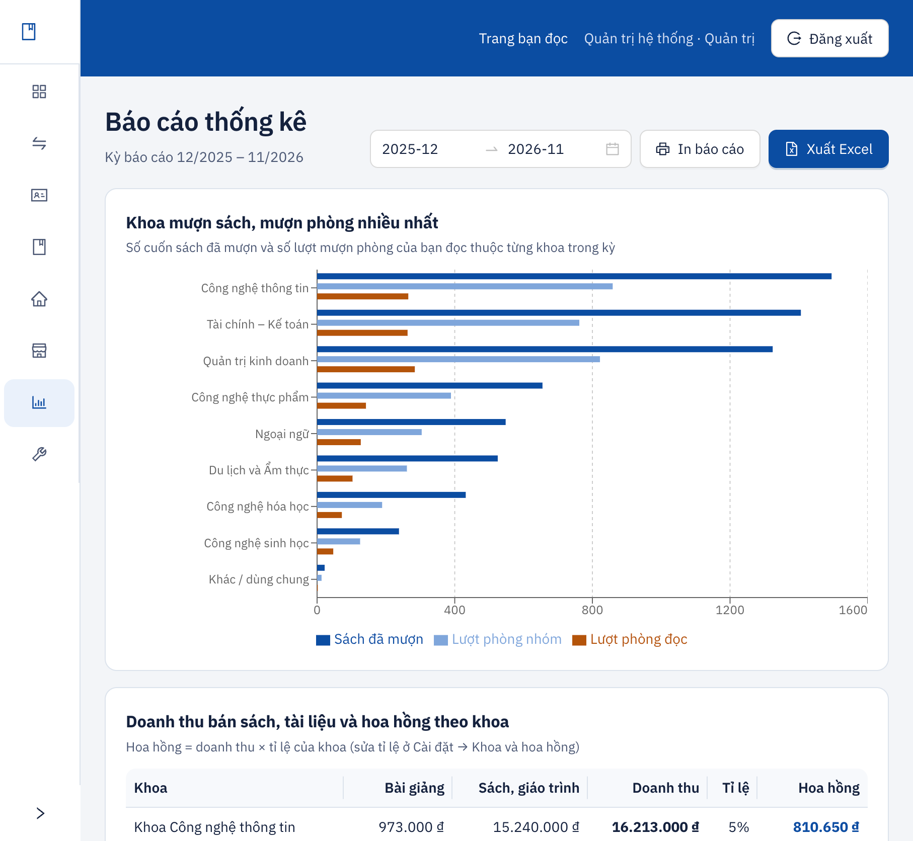

# Hệ thống quản lý thư viện – Trường ĐH Công Thương TP.HCM

[](https://github.com/haidangbdntbqn-bit/library-huit/actions/workflows/ci.yml)

Hệ thống quản lý thư viện cho trường đại học gồm **website bạn đọc và quản trị**, **ứng dụng di động** và **chatbot tiếng Việt**, cùng dùng chung một REST API (Node.js + TypeScript) và CSDL SQL Server. Đây là khóa luận tốt nghiệp của nhóm 3 người.

▶ **Video demo:** <!-- DÁN LINK YOUTUBE VÀO ĐÂY --> https://youtu.be/...

| Trang chủ bạn đọc | Lập phiếu mượn (thủ thư) |
|---|---|
|  |  |
| **Báo cáo thống kê** | **App di động và chatbot** |
|  |  |

## Chức năng chính

- **Bạn đọc:** tra cứu và đặt mượn sách, gia hạn, xem lịch sử mượn, đặt phòng học nhóm theo ca, mua giáo trình và tài liệu, hỏi chatbot.
- **Thủ thư:** lập phiếu mượn và trả sách bằng mã vạch (máy quét, webcam hoặc điện thoại), quản lý kho sách, nhập và thanh lý, xử lý vi phạm, kiểm tra phòng khi trả.
- **Quản trị:** quản lý tài khoản, nhân viên, cấu hình quy định; báo cáo thống kê xuất Excel; xem nhật ký thao tác.

## Kiến trúc

```
Web (React) ─┐
             ├──HTTP──> Backend API (Express + TypeScript) ──Prisma──> SQL Server
App (Expo) ──┘                │
                              └──REST──> Rasa (NLU) ──> Action server ──> Backend API (khóa nội bộ)
```

## Điểm kỹ thuật nổi bật

- **Toàn vẹn dữ liệu:** lập phiếu mượn, trả sách, nhập và thanh lý sách, đặt hàng đều chạy trong `prisma.$transaction`. Trừ tồn kho bằng cập nhật có điều kiện (`stock >= số lượng`) để không bán vượt số còn lại khi nhiều người đặt cùng lúc (`store/orders.routes.ts`).
- **Đặt phòng theo ca:** kiểm tra trùng lịch, sức chứa và đúng khung ca trước khi ghi (`rooms/rooms.service.ts`).
- **Quy tắc nghiệp vụ tách thành hàm thuần** (tiền phạt, gia hạn, điều kiện mượn, hạn thẻ, ca phòng, hoa hồng) trong `rules/rules.ts`, được kiểm thử bằng **37 unit test Vitest** và chạy tự động trên GitHub Actions.
- **Bảo mật:** xác thực JWT, phân quyền 3 vai trò (quản trị, thủ thư, bạn đọc) bằng middleware, kiểm tra dữ liệu đầu vào bằng Zod, ghi nhật ký mọi thao tác thay đổi dữ liệu (audit log).
- **Tác vụ nền:** gửi email nhắc hạn trả tự động mỗi sáng, mỗi bạn đọc tối đa 1 email/ngày.
- **CSDL:** 23 bảng đạt chuẩn 3NF, quản lý thay đổi cấu trúc bằng Prisma Migrate (xem [ERD](docs/erd.md)).

## Công nghệ

| Phần | Công nghệ |
|---|---|
| Backend | Node.js, Express, TypeScript, Prisma, Zod, JWT, Nodemailer, Vitest |
| CSDL | SQL Server 2022 |
| Web | React, Vite, TypeScript, Ant Design |
| Mobile | React Native (Expo) |
| Chatbot | Rasa 3.6 (Python 3.10) |

## Chạy nhanh

Yêu cầu: Node.js 22, Docker. Hướng dẫn đầy đủ (chatbot, app, macOS, lỗi thường gặp) ở [docs/cai-dat.md](docs/cai-dat.md).

```bash
docker compose up -d                 # SQL Server
cd backend && cp .env.example .env
npm install && npm run db:migrate && npm run db:seed
npm run dev                          # http://localhost:5000/api/health

cd ../web && cp .env.example .env
npm install && npm run dev           # http://localhost:5173 (quản trị: /admin)
```

Tài khoản mẫu: `admin / Admin@123`, `thuthu / Thuthu@123`, `sinhvien / Sinhvien@123`.

Chạy kiểm thử: `cd backend && npm test`

## Cấu trúc thư mục

```
backend/src
├── config/        biến môi trường, kết nối Prisma
├── middlewares/   xác thực JWT, phân quyền, kiểm tra dữ liệu (Zod), xử lý lỗi
├── utils/         hàm dùng chung (ngày giờ, sinh mã phiếu, phân trang)
└── modules/<tên>/ mỗi chức năng một thư mục: *.routes.ts (API) + *.service.ts (nghiệp vụ)
web/        React (trang bạn đọc + trang quản trị)
mobile/     React Native (Expo)
chatbot/    Rasa: dữ liệu huấn luyện, custom actions
docs/       danh sách API, ERD, use case, hướng dẫn cài đặt
```

## Phân công


- **Nguyễn Hải Đăng** (nhóm trưởng): thiết kế CSDL, xây dựng backend API, quy tắc nghiệp vụ và kiểm thử, tích hợp chatbot với API.
- **Vũ Hồ Trọng Nhật:** web trang quản trị
- **Nguyễn Huỳnh Trúc Lam:** chatbot Rasa

## Tài liệu

[Danh sách API](docs/api.md) · [ERD](docs/erd.md) · [Đối chiếu yêu cầu đề tài](docs/doi-chieu-yeu-cau.md) · [Lịch sử thay đổi](CHANGELOG.md)
