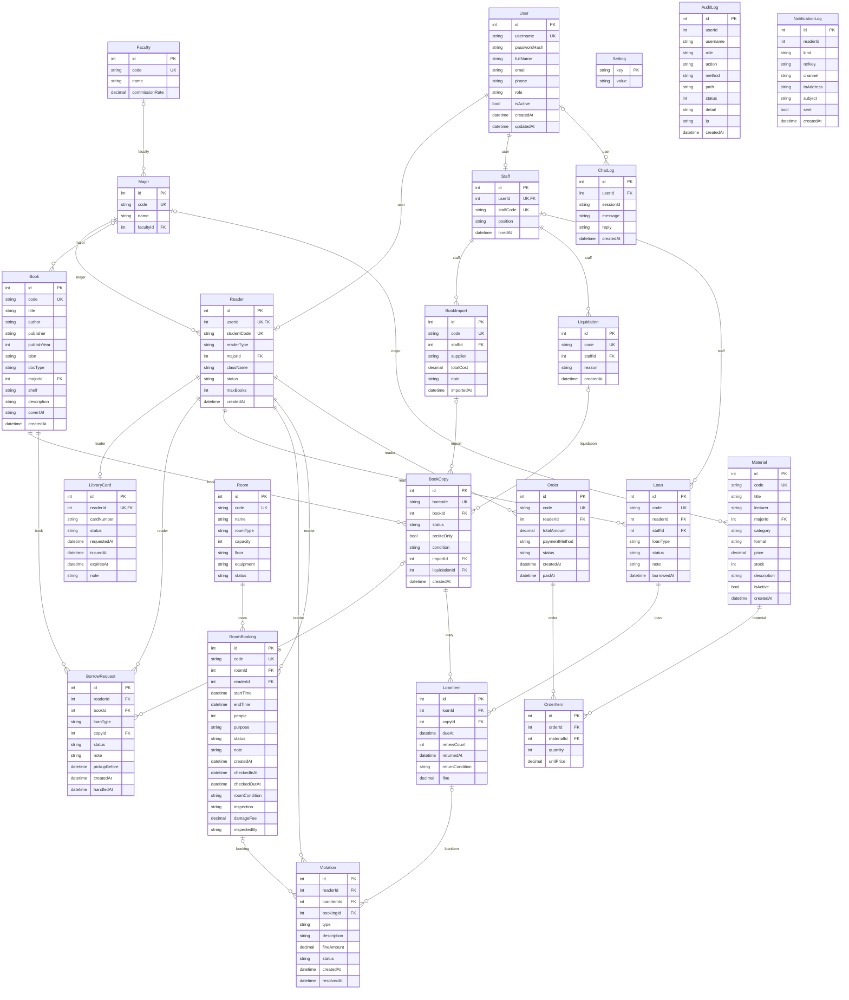

# Sơ đồ quan hệ thực thể (ERD)

CSDL gồm **23 bảng**, sinh tự động từ `backend/prisma/schema.prisma`. Mở file này trong VS Code (extension Markdown Mermaid) hoặc dán khối dưới vào https://mermaid.live để xuất ảnh.

| Bảng | Ý nghĩa |
|---|---|
| Faculty | Khoa |
| Major | Ngành |
| Setting | Quy định |
| User | Tài khoản |
| Reader | Bạn đọc |
| LibraryCard | Thẻ thư viện |
| Staff | Nhân viên |
| Book | Đầu sách |
| BookCopy | Bản sách |
| BookImport | Phiếu nhập |
| Liquidation | Phiếu thanh lý |
| BorrowRequest | Yêu cầu mượn |
| Loan | Phiếu mượn |
| LoanItem | Chi tiết phiếu mượn |
| Violation | Vi phạm |
| Room | Phòng |
| RoomBooking | Lượt mượn phòng |
| Material | Tài liệu bán |
| Order | Đơn hàng |
| OrderItem | Chi tiết đơn hàng |
| ChatLog | Nhật ký chat |
| AuditLog | Nhật ký thao tác |
| NotificationLog | Nhật ký gửi thông báo |

